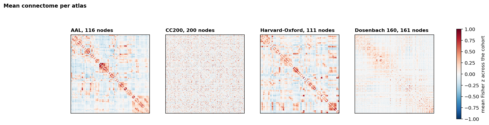

# Connectome Engine Summary

**Generated:** 2026-10-10  
**Engine version:** 1.0.0  
**Pipeline:** cpac  **Strategy:** filt_global  
**Cohort:** `data/splits/qc_cohort.csv`, 861 participants  
**Stored in:** `data/processed/connectomes/cpac_filt_global/` (not committed, rebuild with `python scripts/07_build_connectomes.py`)

Design and conventions: `docs/decisions/0007-connectome-engine.md`. Independent
check of a sample: `docs/reports/connectome_verification.md`.

| Atlas          | Key               |   Participants |   Nodes |   Edges |   Participants with flat regions |   Edges NaN in at least one participant |   Mean z (finite) |   Size MB | Status   |
|:---------------|:------------------|---------------:|--------:|--------:|---------------------------------:|----------------------------------------:|------------------:|----------:|:---------|
| AAL            | rois_aal          |            861 |     116 |    6670 |                               54 |                                    2014 |             0.006 |      46.1 | built    |
| CC200          | rois_cc200        |            861 |     200 |   19900 |                               15 |                                    3969 |             0.008 |     137.3 | built    |
| Harvard-Oxford | rois_ho           |            861 |     111 |    6105 |                              198 |                                    1055 |             0.024 |      42.2 | built    |
| Dosenbach 160  | rois_dosenbach160 |            861 |     161 |   12880 |                               46 |                                    2440 |             0.013 |      88.9 | built    |

- **Nodes** is the graph size for that atlas and **Edges** is nodes x (nodes - 1) / 2,
  the number of distinct region pairs stored per participant.
- **Edges NaN in at least one participant** counts region pairs that touch a flat
  region in somebody. They are NaN on disk and handled by the policy in memo 0007.
- **Status** says whether this run computed the matrices or reused the cache.

