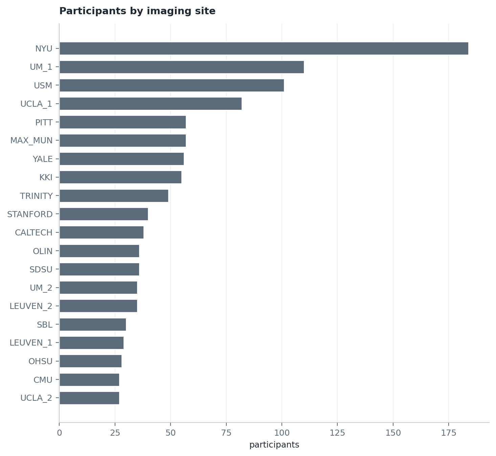
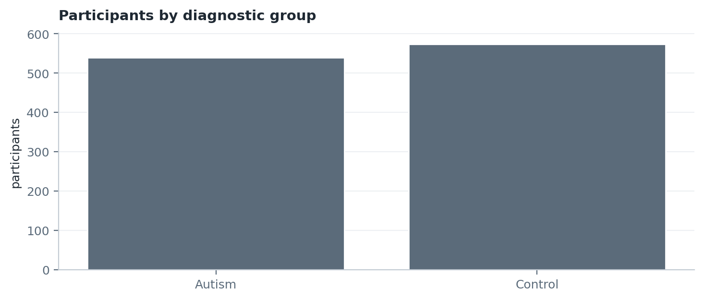
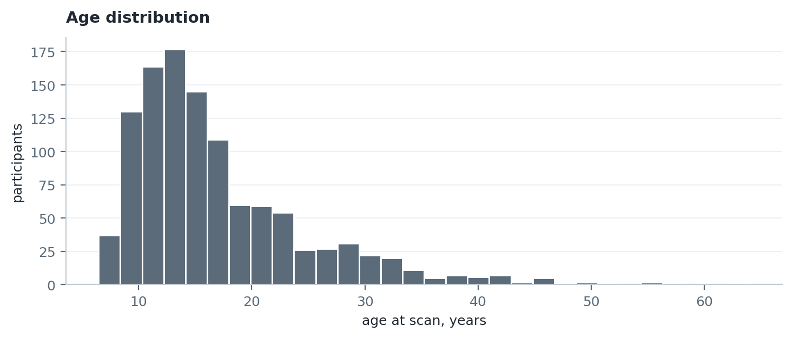
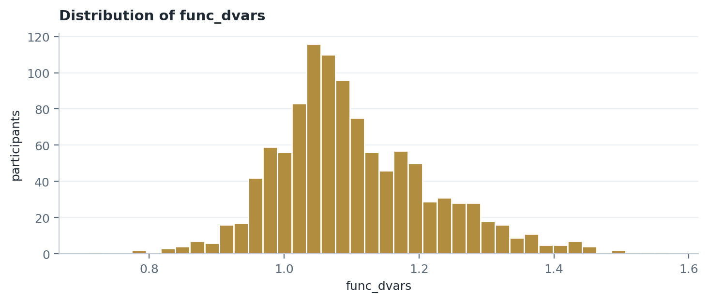

# ABIDE Preprocessed: Metadata Report

**Generated:** 2026-10-02  
**Source file:** `Phenotypic_V1_0b_preprocessed1.csv`  
**Rows:** 1112  **Columns:** 106

This report describes the cohort as distributed. No quality control has been
applied to the counts below unless a section says otherwise.

## 1. Diagnostic group

|   DX_GROUP | label   |   count |   per cent |
|-----------:|:--------|--------:|-----------:|
|          1 | Autism  |     539 |       48.5 |
|          2 | Control |     573 |       51.5 |

## 2. Imaging site

| SITE_ID   |   count |   per cent |
|:----------|--------:|-----------:|
| CALTECH   |      38 |        3.4 |
| CMU       |      27 |        2.4 |
| KKI       |      55 |        4.9 |
| LEUVEN_1  |      29 |        2.6 |
| LEUVEN_2  |      35 |        3.1 |
| MAX_MUN   |      57 |        5.1 |
| NYU       |     184 |       16.5 |
| OHSU      |      28 |        2.5 |
| OLIN      |      36 |        3.2 |
| PITT      |      57 |        5.1 |
| SBL       |      30 |        2.7 |
| SDSU      |      36 |        3.2 |
| STANFORD  |      40 |        3.6 |
| TRINITY   |      49 |        4.4 |
| UCLA_1    |      82 |        7.4 |
| UCLA_2    |      27 |        2.4 |
| UM_1      |     110 |        9.9 |
| UM_2      |      35 |        3.1 |
| USM       |     101 |        9.1 |
| YALE      |      56 |        5   |

## 3. Sex

|   SEX | label   |   count |   per cent |
|------:|:--------|--------:|-----------:|
|     1 | Male    |     948 |       85.3 |
|     2 | Female  |     164 |       14.7 |

## 4. Age bands

| age band    |   count |   per cent |
|:------------|--------:|-----------:|
| under 8     |      18 |        1.6 |
| 8 to 10     |     202 |       18.2 |
| 11 to 13    |     270 |       24.3 |
| 14 to 17    |     272 |       24.5 |
| 18 and over |     350 |       31.5 |

## 5. Site by diagnostic group

This table drives the stratification of the frozen evaluation set.

| SITE_ID   |   Autism |   Control |   Total |
|:----------|---------:|----------:|--------:|
| NYU       |       79 |       105 |     184 |
| UM_1      |       55 |        55 |     110 |
| USM       |       58 |        43 |     101 |
| UCLA_1    |       49 |        33 |      82 |
| MAX_MUN   |       24 |        33 |      57 |
| PITT      |       30 |        27 |      57 |
| YALE      |       28 |        28 |      56 |
| KKI       |       22 |        33 |      55 |
| TRINITY   |       24 |        25 |      49 |
| STANFORD  |       20 |        20 |      40 |
| CALTECH   |       19 |        19 |      38 |
| SDSU      |       14 |        22 |      36 |
| OLIN      |       20 |        16 |      36 |
| LEUVEN_2  |       15 |        20 |      35 |
| UM_2      |       13 |        22 |      35 |
| SBL       |       15 |        15 |      30 |
| LEUVEN_1  |       14 |        15 |      29 |
| OHSU      |       13 |        15 |      28 |
| CMU       |       14 |        13 |      27 |
| UCLA_2    |       13 |        14 |      27 |

## 6. Quality control variables

Accepted values follow `nilearn.datasets.fetch_abide_pcp(quality_checked=True)`,
version 0.14.1.

| column                | distinct values                                                                                                                          | most common   |   count of most common | accepted values           |   passing |
|:----------------------|:-----------------------------------------------------------------------------------------------------------------------------------------|:--------------|-----------------------:|:--------------------------|----------:|
| qc_rater_1            | OK, fail, maybe                                                                                                                          | OK            |                    997 | OK                        |       997 |
| qc_notes_rater_1      | <NA>, dorsal cropped, **Not recommended with niak, ventral edge is cropped, cerebellum & brainstem cropped, misshapen right frontal lobe | <NA>          |                   1073 | not in the nilearn filter |           |
| qc_anat_rater_2       | OK, maybe, fail, <NA>                                                                                                                    | OK            |                    866 | OK, maybe                 |      1060 |
| qc_anat_notes_rater_2 | <NA>, skull-striping fail, skull-striping fail;, skull-striping fail; Motion, stripe, Motion                                             | <NA>          |                    837 | not in the nilearn filter |           |
| qc_func_rater_2       | OK, maybe, fail, <NA>                                                                                                                    | OK            |                    842 | OK, maybe                 |      1049 |
| qc_func_notes_rater_2 | <NA>, ic-cerebellum, Ic-parietal, ic-cerebellum_temporal_lobe, ic-cerebellum-temporal_lobe, ic-parietal-cerebellum                       | <NA>          |                    853 | not in the nilearn filter |           |
| qc_anat_rater_3       | OK, fail, <NA>                                                                                                                           | OK            |                   1003 | OK                        |      1003 |
| qc_anat_notes_rater_3 | <NA>, headmotion, noise, half head, no T1, T2, less headmotion                                                                           | <NA>          |                   1004 | not in the nilearn filter |           |
| qc_func_rater_3       | OK, fail, <NA>                                                                                                                           | OK            |                   1035 | OK                        |      1035 |
| qc_func_notes_rater_3 | <NA>, no func images, no T1, ERROR #5, ERROR #46, bad quality                                                                            | <NA>          |                   1036 | not in the nilearn filter |           |

Applying the standard rater filter to the 5 rater columns present would retain **871 of 1112** participants.

## 7. Head motion and related variables

Columns discovered by pattern rather than assumed. Confirm the intended one
before setting a threshold.

| column       |   count |   mean |    std |   min |   median |     max |
|:-------------|--------:|-------:|-------:|------:|---------:|--------:|
| func_dvars   |    1099 |  1.104 |  0.118 | 0.71  |    1.081 |   1.571 |
| func_mean_fd |    1099 |  0.131 |  0.158 | 0.016 |    0.083 |   1.435 |
| func_num_fd  |    1099 | 27.218 | 42.758 | 0     |    9     | 288     |
| func_perc_fd |    1099 | 12.953 | 18.217 | 0     |    4.972 |  91.736 |

## 8. All column names

```
  1. Unnamed: 0.1
  2. Unnamed: 0
  3. SUB_ID
  4. X
  5. subject
  6. SITE_ID
  7. FILE_ID
  8. DX_GROUP
  9. DSM_IV_TR
 10. AGE_AT_SCAN
 11. SEX
 12. HANDEDNESS_CATEGORY
 13. HANDEDNESS_SCORES
 14. FIQ
 15. VIQ
 16. PIQ
 17. FIQ_TEST_TYPE
 18. VIQ_TEST_TYPE
 19. PIQ_TEST_TYPE
 20. ADI_R_SOCIAL_TOTAL_A
 21. ADI_R_VERBAL_TOTAL_BV
 22. ADI_RRB_TOTAL_C
 23. ADI_R_ONSET_TOTAL_D
 24. ADI_R_RSRCH_RELIABLE
 25. ADOS_MODULE
 26. ADOS_TOTAL
 27. ADOS_COMM
 28. ADOS_SOCIAL
 29. ADOS_STEREO_BEHAV
 30. ADOS_RSRCH_RELIABLE
 31. ADOS_GOTHAM_SOCAFFECT
 32. ADOS_GOTHAM_RRB
 33. ADOS_GOTHAM_TOTAL
 34. ADOS_GOTHAM_SEVERITY
 35. SRS_VERSION
 36. SRS_RAW_TOTAL
 37. SRS_AWARENESS
 38. SRS_COGNITION
 39. SRS_COMMUNICATION
 40. SRS_MOTIVATION
 41. SRS_MANNERISMS
 42. SCQ_TOTAL
 43. AQ_TOTAL
 44. COMORBIDITY
 45. CURRENT_MED_STATUS
 46. MEDICATION_NAME
 47. OFF_STIMULANTS_AT_SCAN
 48. VINELAND_RECEPTIVE_V_SCALED
 49. VINELAND_EXPRESSIVE_V_SCALED
 50. VINELAND_WRITTEN_V_SCALED
 51. VINELAND_COMMUNICATION_STANDARD
 52. VINELAND_PERSONAL_V_SCALED
 53. VINELAND_DOMESTIC_V_SCALED
 54. VINELAND_COMMUNITY_V_SCALED
 55. VINELAND_DAILYLVNG_STANDARD
 56. VINELAND_INTERPERSONAL_V_SCALED
 57. VINELAND_PLAY_V_SCALED
 58. VINELAND_COPING_V_SCALED
 59. VINELAND_SOCIAL_STANDARD
 60. VINELAND_SUM_SCORES
 61. VINELAND_ABC_STANDARD
 62. VINELAND_INFORMANT
 63. WISC_IV_VCI
 64. WISC_IV_PRI
 65. WISC_IV_WMI
 66. WISC_IV_PSI
 67. WISC_IV_SIM_SCALED
 68. WISC_IV_VOCAB_SCALED
 69. WISC_IV_INFO_SCALED
 70. WISC_IV_BLK_DSN_SCALED
 71. WISC_IV_PIC_CON_SCALED
 72. WISC_IV_MATRIX_SCALED
 73. WISC_IV_DIGIT_SPAN_SCALED
 74. WISC_IV_LET_NUM_SCALED
 75. WISC_IV_CODING_SCALED
 76. WISC_IV_SYM_SCALED
 77. EYE_STATUS_AT_SCAN
 78. AGE_AT_MPRAGE
 79. BMI
 80. anat_cnr
 81. anat_efc
 82. anat_fber
 83. anat_fwhm
 84. anat_qi1
 85. anat_snr
 86. func_efc
 87. func_fber
 88. func_fwhm
 89. func_dvars
 90. func_outlier
 91. func_quality
 92. func_mean_fd
 93. func_num_fd
 94. func_perc_fd
 95. func_gsr
 96. qc_rater_1
 97. qc_notes_rater_1
 98. qc_anat_rater_2
 99. qc_anat_notes_rater_2
100. qc_func_rater_2
101. qc_func_notes_rater_2
102. qc_anat_rater_3
103. qc_anat_notes_rater_3
104. qc_func_rater_3
105. qc_func_notes_rater_3
106. SUB_IN_SMP
```

## 9. Figures

**Participants by imaging site**



**Participants by diagnostic group**



**Age distribution**



**Distribution of func_dvars**


